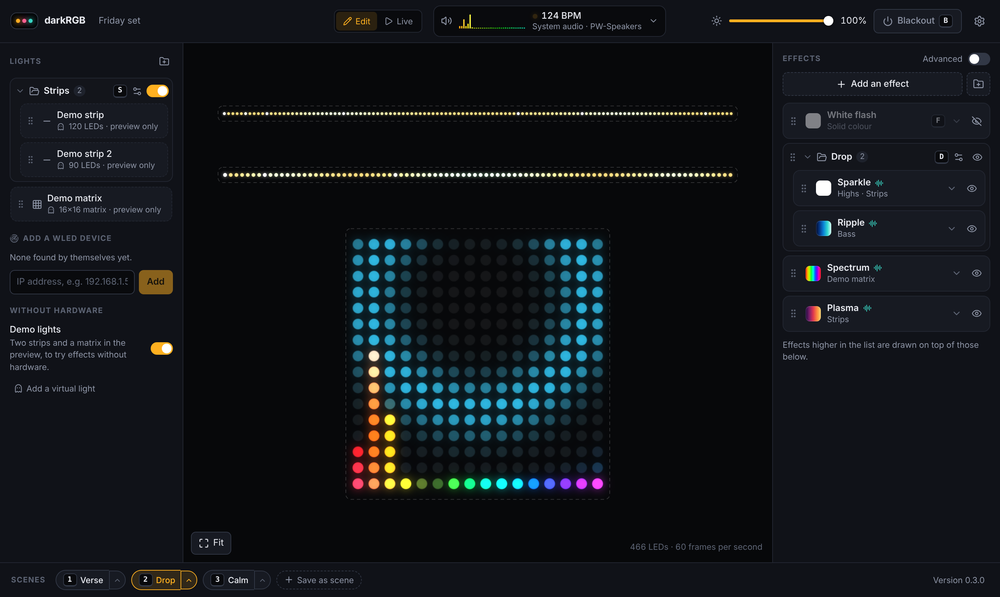

# OpenLightShow

A modern, visual LED show controller for Windows and Linux. One app for three jobs that existing tools split
between them:

- **Audio-reactive:** lights follow whatever the computer is playing, with no audio routing setup.
- **Live:** trigger effects, colours and scenes from the keyboard or a MIDI controller, like a lighting console.
- **Timeline:** pre-programmed shows synced to a song.

It targets ESP32 controllers running [WLED](https://kno.wled.ge/) first, then generic sACN and Art-Net pixel
controllers.



## Status

Version 0.1.0, in development. The first mode, audio-reactive, works end to end against simulated devices and
has been tested on Linux only. It has not yet been run on Windows or against real WLED hardware; see
[docs/roadmap.md](docs/roadmap.md) for what is proven and what is not. Live and timeline modes are not started.

What works today:

- Finds WLED devices on the network (mDNS) or adds them by IP address, and reads their LED count and matrix size.
- Streams 60 frames per second over DDP.
- Captures system audio with no setup and analyses it: loudness, 32 frequency bands, onsets, tempo and beats.
- Ten effects with live controls, stacked in layers, each on all lights or chosen ones.
- A live preview where strips and matrices are arranged by dragging.
- Scenes, master brightness and blackout. The show saves itself.

The UI opens in your browser for now. A desktop window (Tauri) comes later.

## Try it

Builds for Windows and Linux are attached to each run of the
[CI workflow](../../actions/workflows/ci.yml) (open the latest run, download the artifact, unzip).

```
openlightshow              start the app and open the UI
openlightshow audio-test   check that system audio is captured with no setup
openlightshow ddp-test IP  stream a test pattern to one WLED device and report how steady it was
openlightshow discover     list WLED devices found on the network
openlightshow --help       all options
```

No hardware? Run `ols-sim`, which pretends to be two WLED devices on this computer. They appear in the app
like real ones; if they do not, add `127.0.0.1:8081` and `127.0.0.1:8082` by address.

### Checks that still need real hardware

Two things cannot be proven without a real computer and real lights. Each takes a minute:

1. Play music, then run `openlightshow audio-test`. It should end with `RESULT: OK` and name your speakers or
   headphones. This matters most on Windows, where it has never been run.
2. Run `openlightshow ddp-test` followed by a WLED device's IP address. A white dot should glide along the
   lights without stutter for 20 seconds, and the command prints how steady the stream was.

Please report what each one prints, the WLED version, the LED count, and whether the device is on WiFi or
Ethernet.

## Build from source

Needs [Rust](https://rustup.rs/) and [Node.js](https://nodejs.org/) 22 with [pnpm](https://pnpm.io/).

```
cd ui && pnpm install && pnpm build && cd ..
cargo build --release -p ols-engine -p ols-sim
./target/release/openlightshow
```

The UI is embedded in the program, so build it first. `cargo test --workspace` runs the tests, including
end-to-end tests that drive a simulated device.

To work on the UI with live reload, run the engine and Vite side by side:

```
cargo run -p ols-engine -- --no-open
cd ui && pnpm dev          # then open http://localhost:5173
```

## Layout

```
crates/ols-core     layout, layers, effects, renderer (no I/O)
crates/ols-audio    audio capture and analysis
crates/ols-output   DDP, WLED info, discovery
crates/ols-engine   the app: frame loop, commands, server, diagnostics
crates/ols-sim      a pretend WLED device for tests and demos
ui/                 the interface (React, TypeScript, Vite)
docs/               research, architecture, roadmap
```

- [docs/research.md](docs/research.md): what xLights, Vixen and LedFx do well, where they hurt, and the gap.
- [docs/architecture.md](docs/architecture.md): the stack and the core design.
- [docs/roadmap.md](docs/roadmap.md): what is proven, milestones and open decisions.
- [CHANGELOG.md](CHANGELOG.md): what's new in each version.

## Licence

GPL-3.0-or-later. See [LICENSE](LICENSE).
