# darkRGB

A modern, visual LED show controller for Windows and Linux. One app for three jobs that existing tools split
between them:

- **Audio-reactive:** lights follow whatever the computer is playing, with no audio routing setup.
- **Live:** trigger effects, colours and scenes from the keyboard, a touch screen, a phone or a MIDI controller,
  like a lighting console.
- **Timeline:** shows laid out in time against a song, placed by hand or recorded by performing them.

It sends to ESP32 controllers running [WLED](https://kno.wled.ge/), and to pixel controllers that take sACN
(E1.31) or Art-Net.


## Who it is for

Starting a show asks what you are lighting, and sets the show up to suit:

- **A room show**, for a desk, a shelf or a bedroom. Scenes that change by themselves with the music, a calm
  scene to wait in when the music stops, and nothing to learn first.
- **A light show** on a house, in a garden or in a window. Festive scenes (fairy lights, candy cane, snow,
  red and green), long and slow to change, gentle on people passing by. It can keep hours: on at dusk, off
  at bedtime.
- **A live show**, for a party, a dance floor or a stage. Pads to play the lights by hand: white flash,
  strobe, colour pulse, lightning, blackout, tap tempo. Scene changes land on the beat.

Or start blank. The kind of show only decides what it begins with; everything can be changed afterwards.

## Status

Version 0.8.0, in development. Audio-reactive mode and live control are both complete enough to run a show
with: fifteen starter scenes, thirty effects, pads, keys and MIDI controllers, autopilot, any slider tied to
the music, and undo. The timeline plays, records and edits, and has not yet been used for a whole show by
anyone. This version rebuilt the beat clock, added tools that work on any pattern, and made the outputs
kinder to hardware.

**Nothing here has yet met real LEDs or real music.** Every check so far used simulated devices and a
synthetic test song. An outside review of 0.6.0 put that first among its concerns; see
[docs/roadmap.md](docs/roadmap.md).

| | Linux | Windows |
|---|---|---|
| Automated tests | pass | see the latest CI run |
| System audio with no setup | works (PulseAudio and PipeWire, tested with virtual speakers) | works (checked on one Windows PC) |
| The app window | works, keys included (tested under a virtual display) | built by CI; not yet run by anyone since 0.2.0 |
| Real WLED hardware | not yet tried | not yet tried |
| sACN and Art-Net | packets checked against the standards and received by a test program; no real controller yet | the same code; not yet run |
| MIDI controllers | built, and its message handling tested; not yet tried with a real controller | the same |
| Installers | `.deb` and AppImage build | see the latest CI run |
| Power limit, colour order, delay, smoother dimming | checked against a test receiver | the same code; not yet run |
| Timeline | plays against a song in a browser and in the app window; recording and editing checked | not yet run |

The effects, the song-energy tracking and the drop detection have only met synthetic test songs so far, so
expect them to need tuning against real music. See [docs/roadmap.md](docs/roadmap.md) for the details.

**Flashing lights.** Fast flashing can trigger seizures in people with photosensitive epilepsy. Each show has
a flash limit that holds flashing to three a second: strobes slow down to that, and anything else that
flashes faster is softened. A new show starts with it on, and asks you to choose the first time something
flashes fast; a live show starts with it off. With the limit off and other people in the room, that risk is
yours to manage. The limit judges the whole picture and is a safeguard, not a guarantee.

What works today:

- Opens as one window. Finds WLED devices on the network, adds them by address, or scans the network for them.
  Pixel controllers that take sACN or Art-Net are added by address and universe.
- Demo lights and virtual lights that exist only on screen, for trying effects and planning layouts without
  hardware. One click on first run gives demo lights and a show that is already running.
- A simple layout by default, and a full one with every control, switched by one setting.
- Captures system audio with no setup and analyses it: loudness, 32 frequency bands, hits in bass, mids and
  highs, tempo and beats, how big this part of the song is, and when the song moves to a new section.
- A beat that holds: the tempo is kept from memory through a breakdown, bars have a first beat you can set,
  and half time, double time, a nudge and tapping correct it without letting go of the music. Lights fire a
  little early so they land with the sound. A mixer or music program that sends MIDI clock can drive it.
- Thirty effects in layers, among them words and small pictures for matrices. Many keep time with the music:
  a scanner crosses in a beat, tiles reshuffle on the beat, rings leave the middle one a beat. Each can
  play on all lights, chosen ones, a group, or only strips or only matrices; drawn across them or once per
  light; reacting to everything, bass, mids, highs or a frequency range you pick.
- A pattern can be turned, in steps of 45° or to any angle, and set spinning, and the angle can follow the
  music. A matrix hung at an angle, such as a square mounted as a diamond, keeps its pattern the right way up.
- Any pattern can be mirrored, repeated, wrapped into a kaleidoscope, staggered from light to light, and
  have its colours turned round the colour wheel.
- Strips can be bent into shapes: arches, circles, stars, zigzags, outlines, or anything drawn corner by
  corner.
- A timeline: a song, a lane for scenes and a lane for every pad. Clips are placed by hand, snapping to the
  beat, or recorded by playing the show while the song runs.
- Any slider can follow the music (loudness, bass, mids, highs, the beat, hits, the song's energy), a shape
  in time with it (a slow wave, a climb, on and off, a new level by chance), or a fader in the Live view,
  with as much smoothing as you like.
- Colours from built-in palettes or palettes of your own.
- Quiet parts of a song are dimmer and calmer and drops hit harder; a setting says how much.
- Scenes, master brightness and blackout. Autopilot changes scene every few bars and when the song changes,
  choosing calm scenes for quiet parts and big ones for drops. When the music stops, the lights can wait in a
  scene of your choosing.
- Pads and keys for scenes, effects, folders, groups, blackout, tap tempo, a hand-fired beat, next and previous
  scene, and freeze. A press can switch its thing, act only while held, or fire the effect's reaction.
- A Live view with all the pads, set up in place and usable by touch, with faders for speed, sensitivity and
  anything you link to them. Colour pads recolour everything that is playing; pads can be spread over four
  pages; an XY pad bends two settings with one finger.
- MIDI controllers: any pad can learn a note, and knobs and faders can drive brightness, speed, sensitivity
  and the four faders.
- A phone or tablet on the same network as a remote, after giving a six-digit code shown on the computer.
- Undo and redo for every change to a show.
- Hours for a show to keep: lit from one time of day to another, dark in between.
- Care for the hardware: a power limit in amps for each device, a delay to line devices up, the colour order
  for sACN and Art-Net controllers, and lights left dark when darkRGB closes.
- A library: your shows (open, new, copy, rename, delete), and effects, looks and palettes you keep to use in
  any show. Every change saves itself.

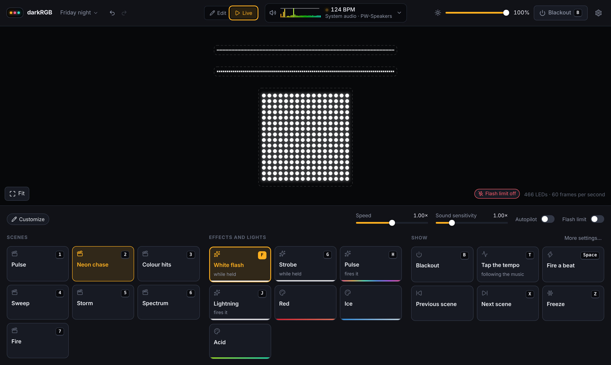

Starting a show, the question about flashing, and the fifteen starter scenes:

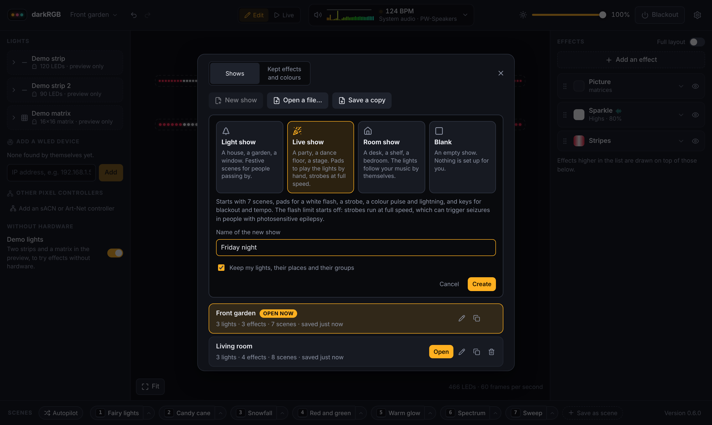

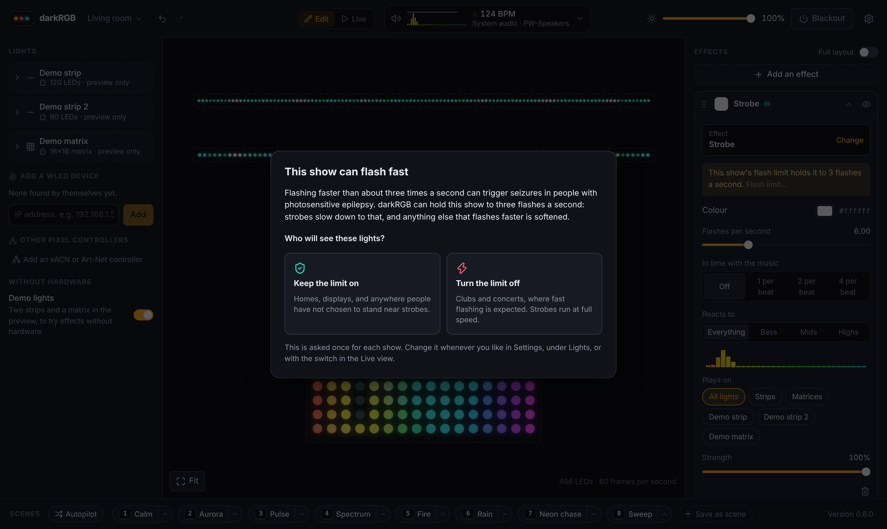

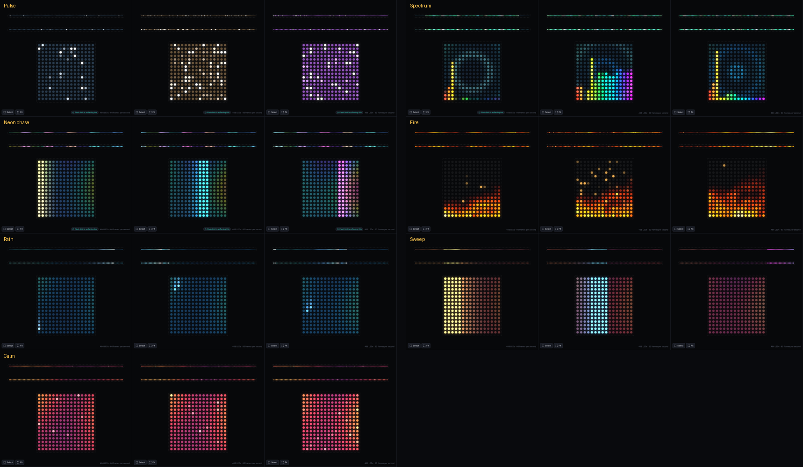

The full layout, with a slider following the bass, and what has been kept for any show:

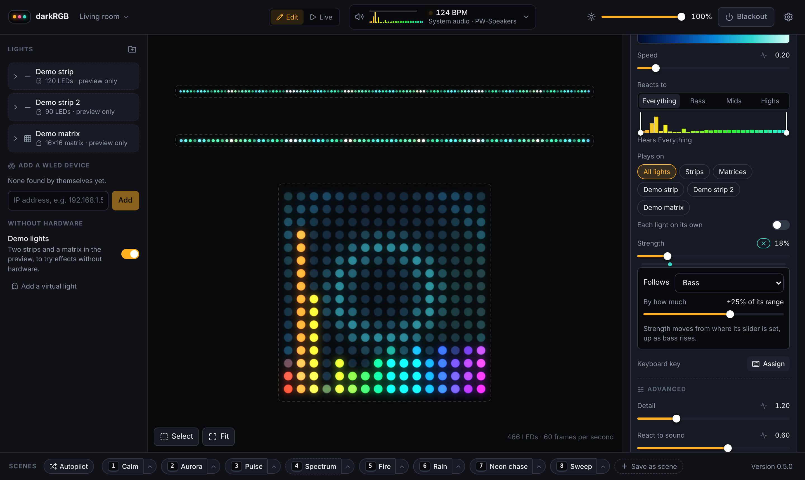

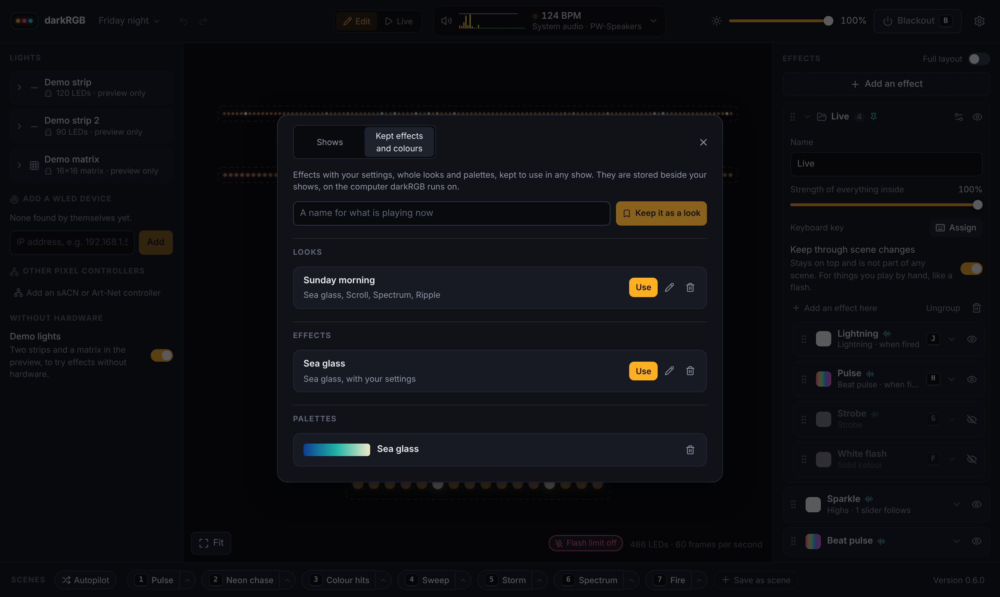

The timeline, with a song, scenes and pads on it:

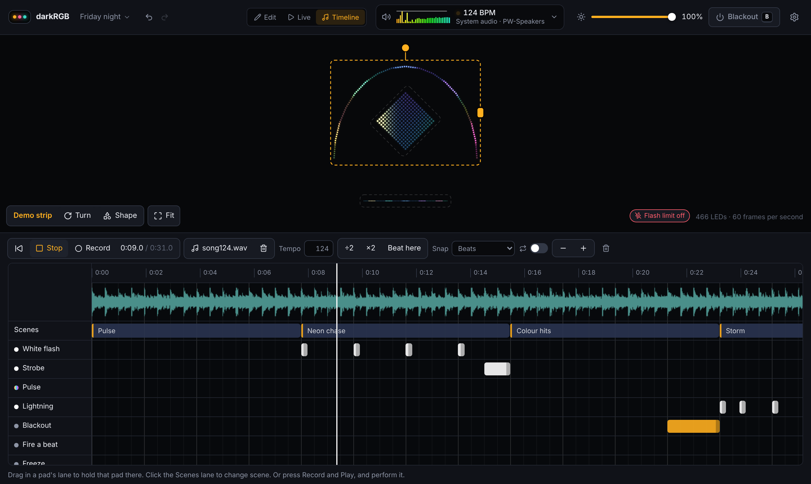

A strip bent into an arch over a matrix hung as a diamond, and the shape editor:

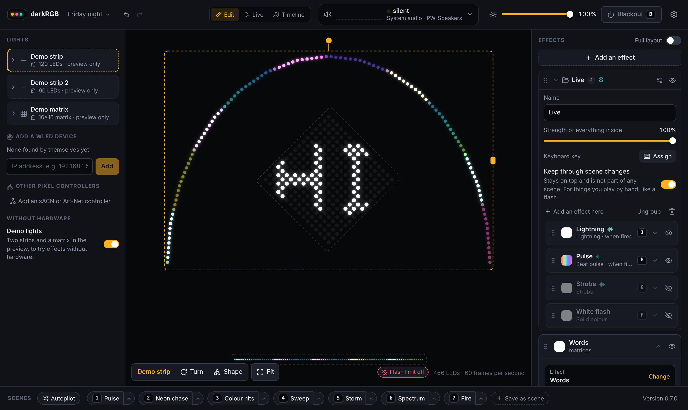

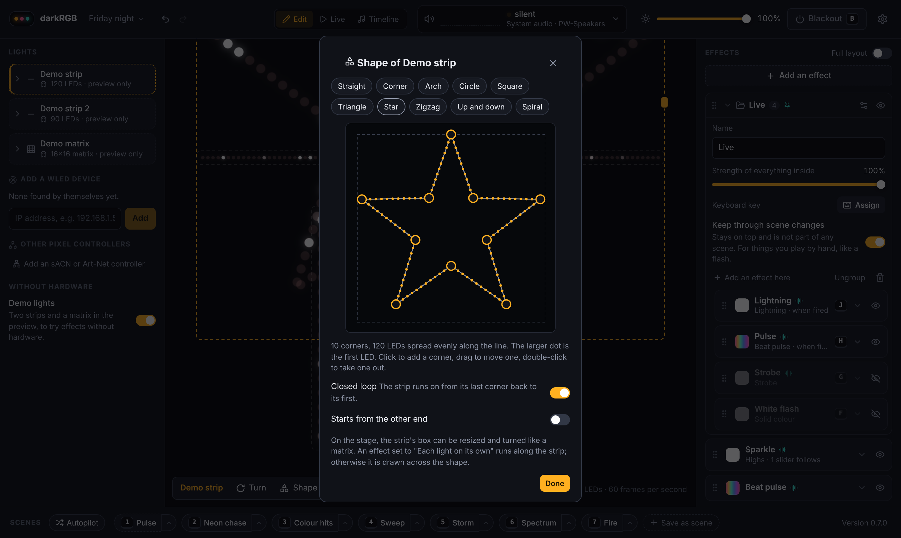

The beat in the Live view: four boxes for the bar, the tempo, and the corrections beside it:

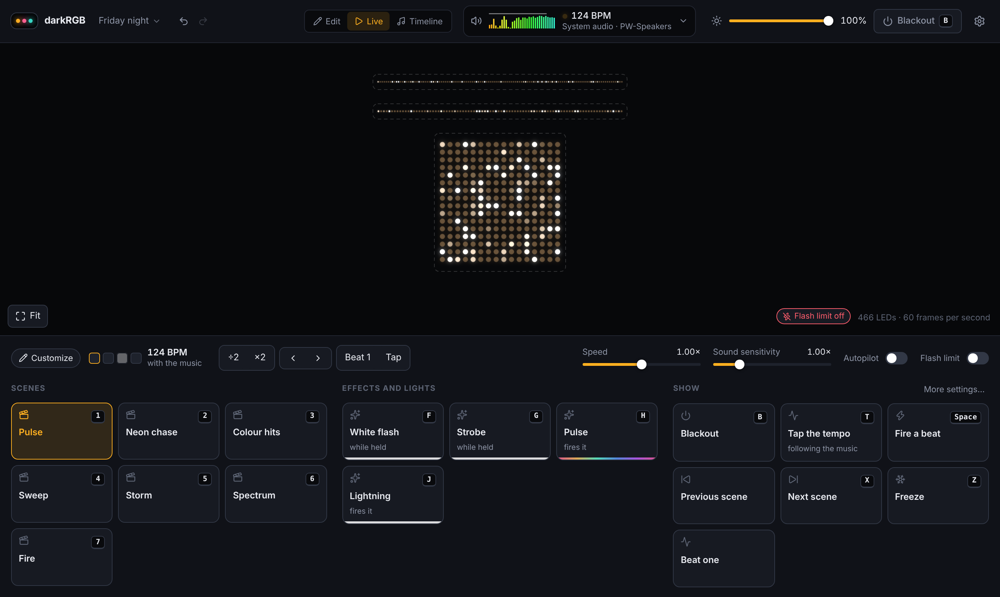

Tools that work on any pattern, here a kaleidoscope of six wedges, and a controller's settings with a power
limit holding it to 4 amps:

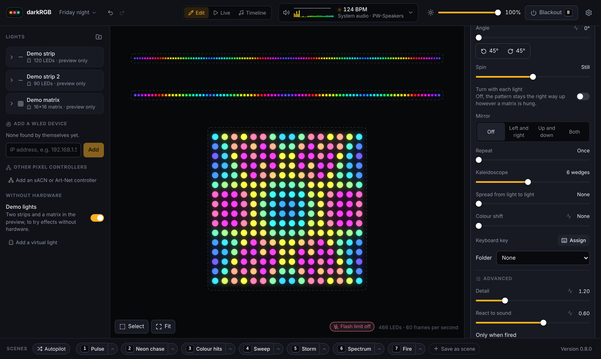

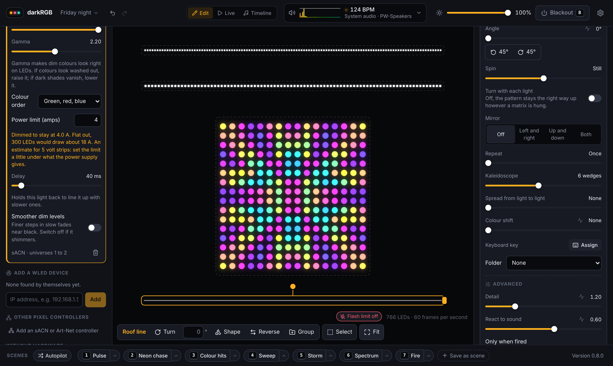

The eight effects added in 0.7.0:

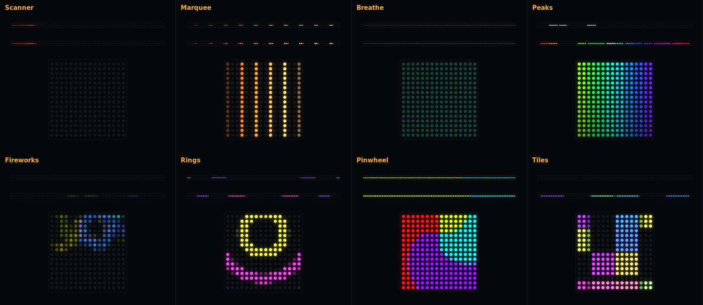

A picture on a matrix, and adding a pixel controller that is not WLED:

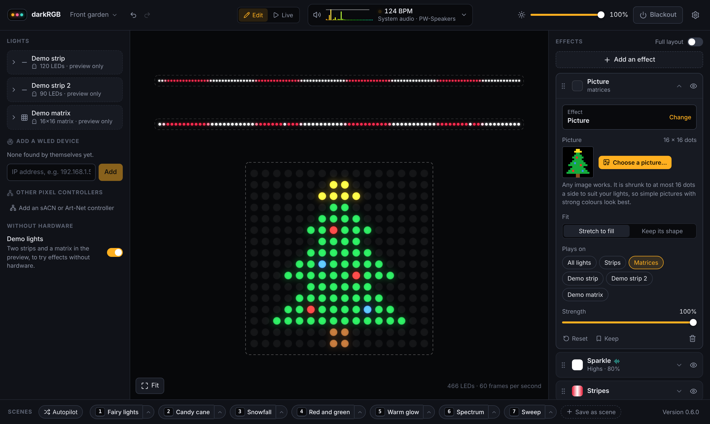

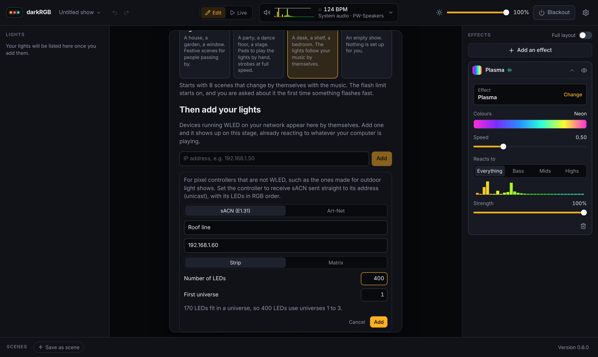

## Try it

Published versions will be on the [Releases page](../../releases): a setup program for Windows, a `.deb` and
an AppImage for Linux, and the plain programs for both. None has been published yet.

Until then, builds for Windows and Linux are attached to runs of the [CI workflow](../../actions/workflows/ci.yml):
open the latest run and download the installers or the plain programs for your system. Downloads are named
with the version and build number, which the app also shows in its bottom corner. Builds are started by hand
("Run workflow" on that page), not on every push, and downloads are kept for a week.

| Program | What it is |
|---|---|
| `darkrgb` | The app. Double-click it. On first run, choose "Try it with demo lights" if you have no hardware to hand. |
| `darkrgb-cli` | The same engine from a terminal. Opens the UI in your browser, and has the checks below. |

Windows will warn that the programs are unsigned. Every download carries `THIRD-PARTY-LICENSES.txt`, the
licences of the libraries built into it. The app window uses the system's web engine: WebView2 on
Windows (part of Windows 11, and installed with Edge on Windows 10) and WebKitGTK 4.1 on Linux
(`libwebkit2gtk-4.1-0`, present on most desktops). `darkrgb-cli` needs neither.

```
darkrgb-cli                start the engine and open the UI in a browser
darkrgb-cli --lan          also let phones on your network open it, once they give the code it prints
darkrgb-cli audio-test     check that system audio is captured with no setup
darkrgb-cli ddp-test IP    stream a test pattern to one WLED device and report how steady it was
darkrgb-cli discover       list WLED devices found on the network
darkrgb-cli midi-test      list MIDI controllers and print what they send
darkrgb-cli --help         all options
```

### The check that still needs real hardware

Run `darkrgb-cli ddp-test` followed by a WLED device's IP address. A white dot should glide along the lights
without stutter for 20 seconds, and the command prints how steady the stream was. Please report what it prints,
the WLED version, the LED count, and whether the device is on WiFi or Ethernet.

## Build from source

Needs [Rust](https://rustup.rs/) (the version in `rust-toolchain.toml` is installed for you) and
[Node.js](https://nodejs.org/) 22 with [pnpm](https://pnpm.io/). On Linux, MIDI needs `libasound2-dev` and the app window needs the rest:

```
sudo apt install libasound2-dev libwebkit2gtk-4.1-dev libgtk-3-dev libxdo-dev librsvg2-dev libayatana-appindicator3-dev
```

```
cd ui && pnpm install && pnpm build && cd ..
cargo build --release -p darkrgb-desktop -p darkrgb-engine
./target/release/darkrgb
```

The UI is embedded in the programs, so build it first. `cargo test` runs the tests, including end-to-end tests
that drive a simulated device; it does not build the app window, so it needs none of the Linux packages above.

To work on the UI with live reload, run the engine and Vite side by side:

```
cargo run -p darkrgb-engine -- --no-open
cd ui && pnpm dev          # then open http://localhost:5173
```

`cargo run -p darkrgb-sim` starts pretend WLED devices that speak the real network protocol, for testing
discovery and streaming without hardware.

## Layout

```
crates/core      layout, layers, effects, renderer, flash limit (no I/O)
crates/audio     audio capture and analysis
crates/output    DDP, sACN, Art-Net, WLED info, discovery, network scan
crates/engine    the engine as a library (commands, live state, MIDI, pairing, library of shows), and darkrgb-cli
crates/desktop   darkrgb, the app window (Tauri)
crates/sim       a pretend WLED device for tests
ui/              the interface (React, TypeScript, Vite)
tools/           the script that lists third-party licences for a build
docs/            research, architecture, roadmap
```

- [CONTRIBUTING.md](CONTRIBUTING.md): how to build, test and send changes.
- [SECURITY.md](SECURITY.md): what the program exposes on a network, and how to report a problem.
- [docs/research.md](docs/research.md): what xLights, Vixen and LedFx do well, where they hurt, and the gap.
- [docs/architecture.md](docs/architecture.md): the stack and the core design.
- [docs/roadmap.md](docs/roadmap.md): what is proven, what comes next, open decisions.
- [CHANGELOG.md](CHANGELOG.md): what's new in each version.

## Licence

GPL-3.0-or-later. See [LICENSE](LICENSE).
