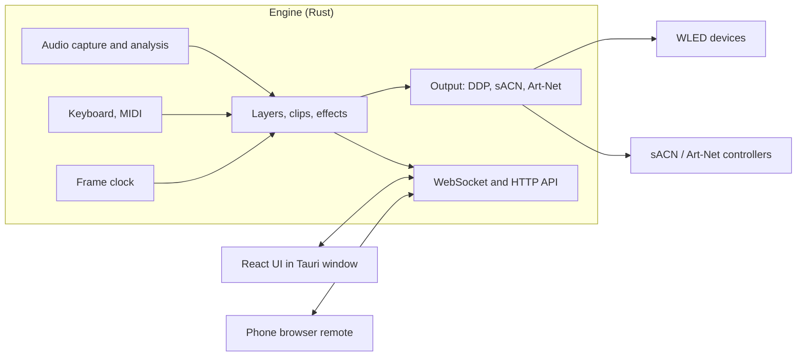

# Architecture

Decided on 2026-11-10. As of version 0.3.0 the engine, the app window, the UI and the device simulator exist,
and live mode has its first cut (keys, pads, tap tempo); MIDI and the timeline do not exist. Sections say
which parts are built. Items marked **(to verify)** are
assumptions that the checks in [roadmap.md](roadmap.md) test.

## Why installed software, not a website

A browser cannot do the core jobs:

- It cannot send UDP, so no DDP, sACN or Art-Net.
- It cannot discover devices by mDNS.
- It can capture system audio only in Chrome/Edge on Windows, after the user ticks a box each time; on Linux it
  offers tab audio only.
- Timers are throttled in background tabs, which breaks a steady frame clock.
- A hosted HTTPS site that talks to `http://wled.local` hits Chrome's local-network permission prompts.
  [Chrome docs](https://developer.chrome.com/docs/modern-web-guidance/guides/security/local-network-access)

So a native engine is required. The UI is still built with web technology and served by that engine, which means
a phone on the same network can open it as a remote. A public website is only needed for a landing and docs page.

## Stack

| Part | Choice | Why |
|---|---|---|
| Engine | Rust, a headless process | Steady 60 fps with no garbage-collector pauses; good audio, MIDI and network crates |
| UI | TypeScript, React, Vite | Largest contributor pool; modern look is easy; WebGL2 for the preview, Canvas for the timeline |
| Desktop shell | Tauri v2 | One window with the engine in the same process; installers and auto-update later |
| Engine to UI | WebSocket and HTTP on localhost | Keeps the shell replaceable; also serves the phone remote and a headless mode |



### The Linux webview risk

Tauri uses the system WebKitGTK on Linux. Tauri's docs carry a page of workarounds for Linux graphics problems,
WebGPU is not confirmed there, and the Chromium (CEF) backend for Tauri has no release date.
[Tauri Linux graphics](https://v2.tauri.app/develop/debug/linux-graphics/)

Mitigation: the UI talks to the engine only over the WebSocket, never through Tauri-specific calls. The page
in the window is given no access to the system at all. `darkrgb-cli` serves the same UI to any browser, which
is the fallback today, and the same UI would run in Electron on Linux with no engine changes. Design for
WebGL2, not WebGPU.

Status: the window works on Linux under a virtual display with WebKitGTK 2.52, including the WebGL2 preview.
Its speed on a real graphics card is not measured.

### Alternatives considered

- **Pure Rust UI (egui + wgpu):** one process and the lowest latency, but a utilitarian look, a hand-built
  timeline and a smaller contributor pool. Kept as the fallback if the web UI cannot hit preview frame rates.
- **Python (like LedFx):** fast to start, but timing jitter at tens of thousands of pixels.
- **C++ with Qt or JUCE:** proven in lighting (QLC+, Chataigne) but slower to build and harder to attract help.
- **.NET with Avalonia:** productive, weaker real-time audio and MIDI libraries.
- **Electron everywhere:** consistent Chromium, at about 100 MB more download. Held in reserve for Linux.

## Core design: one engine, three ways to drive it

### Layout

- A **device** is something that shows pixels. It is either a WLED box on the network or a **virtual** light,
  which exists only in the preview and is never sent anywhere. The built-in demo lights are three virtual
  lights added and removed as a set.
- A **fixture** is a strip, matrix or custom shape on a device output, with a pixel count and a position on a 2D
  canvas (3D later).
- A **group of lights** collects fixtures under a name. A layer can target a group, so lights added to the
  group later are included; a group has its own brightness and on/off switch, applied after the layers are
  mixed. A fixture is in one group or none. Built.
- A strip can be **bent** (`Fixture.path`): it passes through corners given as places in its box, from (0, 0)
  to (1, 1), and its LEDs are spread evenly by distance along the line, which may close on itself. The box
  resizes and turns like a matrix's. Drawn on each light by itself, an effect still runs along the strip;
  drawn across the lights, it is drawn across the shape.
- Effects render in layout space, so one effect can sweep across fixtures on different devices.
- A layer's pattern can be **turned** (`Layer.angle`, `Layer.spin`, and a link to `angle`). The renderer
  turns each light's place in the pattern about the middle and rescales, so the pattern's width and height
  become the extent of the lights along the turned axes: every light still lands inside the pattern, and no
  effect sees a place outside 0..1. A line of lights has one direction only and is left alone.
- Drawn on each light by itself, a pattern on a matrix is turned back by as much as the matrix is turned on
  the canvas, so it stays the right way up in the room: turning a matrix on the canvas says how it hangs.
  `Layer.turns` gives the older behaviour, the pattern turning with the light.
- The user never sees universe or channel numbers. The engine derives packets from the layout.

### Clips, layers and modulators

- A **clip** is an effect instance with its parameters. Clips sit on **layers**, and layers blend (normal, add,
  multiply, mask).
- The three modes differ only in what starts and stops a clip:

| Mode | What starts a clip | Typical parameter source |
|---|---|---|
| Audio-reactive | Always on | Audio bands, beat |
| Live | Key or MIDI press (flash, toggle, hold) | Knobs, tap tempo |
| Timeline | The playhead reaching it | Curves drawn by the user |

- A **modulator** drives any parameter: a curve, an audio band, the beat phase, an LFO or a MIDI control. The
  same system works in every mode.
- **Record live into the timeline:** because live triggers and timeline clips are the same thing, a keyboard
  performance played over a song can be recorded as clips and then edited. This is the intended fast path for
  making pre-programmed shows.
- Every change goes through a command. The same commands will serve the UI, the phone remote, MIDI mappings
  and recording. Commands are validated in one place (`crates/engine/src/commands.rs`). Undo is not built.

Built so far: layers that are always on (the audio-reactive case) or switched and fired by pads (below), four
blend modes, folders, scenes, and per-layer sound settings (below). Clips with start and stop times,
modulators on individual parameters, and recording are not built.

A layer is drawn once across all the lights it plays on, in the canvas's coordinates, or, with **each light
on its own**, once per light in that light's own frame (`Segment` in `crates/core/src/render.rs`). The second
is what makes a fire burn from the bottom of every strip instead of from the bottom of the room.

### Folders

A **folder** groups layers. The stack stays one flat list, bottom to top, and each layer names the folder it
is in; the rule that a folder's layers sit next to each other is restored after every change
(`Show::tidy_layers`). A folder can switch off everything inside it and scale its strength. The UI rearranges
by sending the whole new order (`arrange_layers`), which the engine refuses if it does not name exactly the
layers that exist, so a stale drag cannot scramble the stack. A scene stores its folders along with its
layers.

A folder can be **pinned**. Pinned folders sit on top of the stack and are not part of any scene
(`Show::scene_part`, `Show::scene_stack`): recalling a scene replaces everything else and leaves them where
they are. That is where effects played by hand live, such as a white flash, so a scene change cannot take
them away mid-song. Limits: 32 layers outside pinned folders, 16 inside.

Ids are unique across everything in a show, so one list of targets on a layer can hold fixtures and groups of
lights alike.

### Live: pads, keys, tempo

A **binding** is a pad: an action, what a press does, and optionally a key. Actions: switch to a scene,
switch an effect, a folder or a group of lights, blackout, tap the tempo, fire a beat, next scene, previous
scene, freeze. A press can **switch** its target, act only **while held**, or **fire** an effect or folder
(`KeyMode`; `Action::allowed` says which actions take which). Keys are stored by position (`KeyA`), with the
printed label kept for display, so a show works on any keyboard layout. A key has one action and an action
one pad. The order of the list is the order of the pads.

The UI turns presses into `trigger` commands (binding id, down or up), or `perform` for an action that has no
pad; the engine decides what they do. That keeps the door open for MIDI, which the engine will listen to
itself and feed into the same path.

What is live and not saved lives in `crates/engine/src/live.rs`, as pure logic with the time passed in:

- **Held pads.** A "while held" pad flips its target only in the copy of the show the frame loop renders
  (`Live::overlay`); the saved show never changes. A held scene swaps in that scene's stack the same way.
  Each client's held pads are released when its connection closes, and the UI lets go when the window loses
  focus.
- **Fired effects.** Firing raises the beat and hit signals for one layer only, for a moment (`Cues`, passed
  to `Renderer::render_with`), so that effect goes off and the others do not. A layer set to react **only
  when fired** hears silence otherwise (`Sound.manual`).
- **Freeze.** The show clock stops and the sound is held as it was, so every effect keeps drawing the same
  picture. Brightness and blackout still work.
- **Speed.** The show clock runs at 0.25 to 4 times real time.
- **Tapped tempo.** Two or more taps set a tempo that replaces the one found in the music (beat, phase, count)
  until cleared. The first tap of a run is the first beat of four.
- **Hand-fired beats.** Raise the beat and hit signals for every layer for a moment.
- **A waiting scene.** With scene changes set to wait, a requested scene starts on the first beat (or fourth
  beat) that begins after it was asked for, or after a few seconds if no beat comes.
- **Waiting for music.** After a chosen stretch of silence the scene set aside for it takes the place of what
  is playing, in the rendered copy only, with a fade; the first sound brings the show back. Choosing a scene
  by hand ends the waiting. Autopilot is paused meanwhile.
- **Autopilot.** Counts bars on the beat and asks for the next scene (in order or shuffled, skipping scenes
  marked to sit out, and passing over calm scenes in big parts of a song and big scenes in quiet ones) every
  2, 4, 8 or 16 bars; by the clock when no tempo is found. A change of section in the
  song brings the next scene at once and restarts the count. A scene the user asks for always comes first,
  and also restarts the count. A section change within 4 seconds of a scene change is ignored, so one
  transition in the music gives one change of scene.

A scene change can **fade**: the frame loop keeps the outgoing show and its renderer alive, renders both, and
mixes them until the fade is over. The incoming scene starts with a fresh renderer; the fade hides the
restart.

**Undo** keeps whole copies of the show, a hundred at most. A command is remembered unless it is part of
performing (master brightness, the faders, speed, sound, the page of pads); those values are carried across
an undo, so undoing an edit never moves the brightness. A run of the same command within 900 ms, such as a
slider being dragged, is one step.

**MIDI** is heard by the engine (`midi.rs`, with `midir`), not the web view, so it works in every window and
browser. A pad holds a note and channel; a knob holds a controller number and what it drives. "Learn" is a
state in the engine: the next note or knob message is bound to whatever is waiting. Knob messages arrive
far faster than frames, so only the last value for each target is kept and applied once a frame.

**Colour pads** hold a palette. While one is on, the renderer hands that palette to every palette setting of
every layer; nothing in the show is rewritten, so letting go gives the colours back. **Pages**: a pad
belongs to one of four pages or to all of them, and a key or note is unique only among pads that share a
page.

A show's **hours** (`Schedule`) are minutes after midnight. The frame loop checks the computer's clock about
once a second; outside the hours it blacks out the rendered copy, so the show's own blackout is untouched.

Sound can be **delayed** for speakers that play late: the frame loop keeps a short history of audio features
and reads from the past. The tapped tempo is not delayed, since it is tapped to what the user hears.

### The flash limit

Fast flashing can trigger seizures in people with photosensitive epilepsy, and this program makes fast
flashing easy. The limit is the last step of the frame loop (`FlashGuard` in `crates/core/src/safety.rs`), so
nothing can get around it and the preview shows what the lights do.

The choice belongs to the show (`Show.flash`), because it depends on who will see the lights. A show starts
with the limit on and `decided` false; the first time it has an effect made to flash, or the limit softens
something, the UI asks whether to keep it. A live show starts with it off.

Effects say what they have to do with flashing (`FlashUse`), so that nothing has to be designed around the
limit. Most say nothing. Strobe is `Capped`: while the limit is on it runs at just under the limit, on every
second or fourth beat when it is locked to the music, so its flashes stay whole instead of being softened.
Lightning is `Needed`: a burst slowed to three flashes a second is not a burst, so the renderer leaves it out
while the limit is on, and the UI says why.

It watches the average luminance of the whole picture. A **flash** is a rise of at least a set share of full
brightness, followed by a fall. At most three flashes are let through in any second, and never two closer
together than a quarter of a second. A rise over the limit is held just under the threshold: the colours stay,
the jump becomes a swell, and brightness that stays is reached a moment later. Two levels: **hard flashes**
(the default) counts a rise of a quarter of full brightness; **strict** counts a tenth, the figure used for
screens. At a tenth most beat-driven looks are softened, which is why it is the option and not the default.
Setting the limit to zero switches it off, in one click, with a marker left on the stage.

What it does not do: it looks at the picture as a whole, so one small light flashing fast among many steady
ones is not held back; and it knows nothing about how large the lights are in someone's view or about
saturated red, both of which the full guidance for screens considers.

### Starter looks

`crates/core/src/looks.rs` holds fifteen ready-made scenes as data: a few layers each, with parameters, links,
where they play (all lights, strips only, matrices only) and the parts of a song they suit. `Show::add_look`
turns one into an ordinary scene, so nothing about them is special once added.

A show has a **kind** (`Kind`: room, display, club or custom in files; Room show, Light show, Live show and
Blank on screen), chosen when it is started. `Kind::looks` says
which looks a kind gets and in what order; `commands::set_up` adds them and sets how scenes change, the scene
to wait in when the music stops, and for a live show the pads and the flash choice. The kind decides how a show
begins and nothing after that.

"Strips only" is a rule on the layer (`Layer.only`), not a list of lights, so a look added before the lights
are there still lands where it should.

### Links: settings that move by themselves

A layer can carry **links** (`Link`: a setting, a source, an amount). Each frame the renderer works out where
every source stands (`Source::value`): loudness, the beat and hits as the layer hears them; bass, mids, highs
and the song's energy from the whole sound; a slow wave counted in beats; one of four faders. A linked setting
is moved from where its slider is set by `amount` of its range, clamped to the range, for that frame only
(`linked_settings` in `render.rs`). The stored show is never changed, so a link cannot drift. The layer's
strength can be linked under the name `opacity`.

### Colours

A palette setting holds either the id of a built-in palette or the user's own colours written out
(`#e8112d,#ffffff|loop`; see `color::parse_custom`). Carrying the colours in the setting itself means a scene,
a copy or a kept pattern needs nothing looked up to keep its colours.

### What a layer hears

Each layer has sound settings: a **band** (everything, bass, mids, highs, or a custom range across the 32
bands), a **sensitivity**, and how much its **brightness follows the sound**. The renderer hands each effect
its own view of the audio (`AudioFeatures::routed` in `crates/core/src/audio.rs`): the level, the bands
(spread across the full width), and hit detection all come from the chosen part of the spectrum. The beat is
left alone, since it follows the tempo of the whole song. Effects need no code for any of this.

**The shape of the song.** Levelling makes a quiet verse and a loud chorus read the same, which is right for
"is there a hit now" and wrong for "is this the big part". So the analysis also keeps a slow measure
(`SectionMeter` in `crates/audio/src/analysis.rs`): loudness averaged over about 1.5 seconds, placed within
the range heard over the last 45 seconds. That gives **intensity**, 0 to 1. A lasting jump or fall in it, or a
surge well above anything heard recently, counts as a new **section**, with a **drop** flag on the way up; a
few seconds must pass before the next one. The renderer uses intensity to dim and slow listening layers in the
quiet parts, by an amount the user sets (`audio.dynamics`; 0 switches it off). Autopilot uses the sections.

### Simple first

Every parameter is marked basic or advanced, and the defaults of advanced ones must give a good result
untouched. The UI has two layouts, chosen by one setting kept on each device. The simple one shows basic
settings and leaves out what a first show does not need: folders, groups of lights, virtual lights, how
effects mix, links, keys on effects, frame rate, and the details of autopilot. The full one shows everything.
Nothing a show already uses is hidden: a key, a link or a fade that is set shows in the simple layout too. Effects also carry a category,
which groups them in the picker.

### Effects

- An effect is a function of time, audio features, parameters and pixel positions that writes colours.
- Each effect declares its parameters (name, type, range) so the UI builds controls automatically.
- Built-in effects are Rust. Later, user effects as WGSL shaders or WASM plugins.
- Effects work with the colours a colour picker shows, as floating point. Gamma and the brightness cap are
  applied per device at the end; colour order and RGBW conversion will go there too.

### Timing and threads

- Audio callback thread: copies samples into a lock-free ring buffer and does nothing else.
- Analysis thread: FFT and features per hop.
- Render thread: fixed tick (60 a second by default; 30, 40 and 120 can be chosen), renders layers, hands
  frames to output. The preview is sent about 30 times a second whatever the tick. 120 is there for short
  strips and wired controllers: the common WS2812 LEDs take about 30 microseconds each, so one output can
  refresh about 110 times a second with 300 LEDs and 33 with 1,000, and the UI shows that ceiling per light.
- Output: UDP sends, paced per device.
- API and discovery: async tasks (tokio).
- Clock: a monotonic clock in audio-reactive and live modes; the audio playback position in timeline mode, so
  lights stay locked to the song.

## Audio with zero setup

| OS | Method | Status |
|---|---|---|
| Windows | WASAPI loopback of the default output, through `cpal`: opening an output device as an input stream enables loopback. Needs no driver or user setting. [Microsoft](https://learn.microsoft.com/en-us/windows/win32/coreaudio/loopback-recording) | Passed `audio-test` on one Windows PC (100% of audio received) |
| Linux | The monitor source of the default sink, through the PulseAudio protocol with the pure-Rust `pulseaudio` client. PipeWire answers the same protocol. | Tested on PulseAudio 16.1 and PipeWire 1.0.5 |
| macOS | A CoreAudio tap on the default output through `cpal` (macOS 14.6+) | Same code path as Windows; untested |

Why Linux does not use `cpal`: in `cpal` 0.18.2 the PulseAudio host either delivers recordings in chunks of
about two seconds (default buffer) or drops about half the audio (fixed buffer). Both were measured on
2026-11-10. A fix is unreleased upstream. Talking to the server directly with a 10 ms fragment size delivers
all of it.

- Follows the default device when the user switches headphones or speakers (checked every two seconds), and
  reconnects if the sound server restarts.
- Analysis (`crates/audio/src/analysis.rs`): mono mix, a 2048-sample windowed FFT every 512 samples at
  48 kHz, 32 mel bands, automatic gain, onset detection by spectral flux, and a tempo and beat tracker
  (autocorrelation of onset strength, 70 to 190 BPM). Tap tempo is not built.
- Each band, each group (bass, mids, treble) and the overall level is read between its own recent quiet level
  and recent peak, so treble shows next to a loud kick and a steady bass line does not hide the kick on top
  of it. The tempo tracker uses the unlevelled signal, weighted toward bass, so hi-hats are not mistaken for
  the beat.
- Hits are detected for the whole spectrum and for bass, mids and treble separately. A group far quieter than
  the loudest group (22 dB) is treated as spill, so a kick's click is not a treble hit.
- Latency offset per device. Loopback audio arrives before a Bluetooth speaker plays it, so lights sometimes need
  to be delayed, not sped up.
- Optional later on Windows: capture one application only, so notification sounds do not flash the lights
  (process loopback, documented for recent Windows builds).
- For timeline mode, songs are decoded with `symphonia` and analysed ahead of time for a beat grid and waveform.

## Outputs

### WLED (first-class)

- **Discovery:** mDNS service `_wled._tcp`. When that finds nothing (multicast blocked, some Windows setups),
  the user can scan: the engine asks all 254 addresses of a /24 network for `/json/info`. It runs only on
  request and only on private address ranges. The UI pre-fills the address field with this computer's network
  prefix, since devices are almost always on the same network.
- **Auto-setup:** `GET /json/info` gives `leds.count`, `leds.matrix.w` and `.h` for 2D setups, `name`, `mac`,
  `ver`, `arch`, and whether another source is streaming (`live`, `lm`, `lip`).
  [JSON API](https://kno.wled.ge/interfaces/json-api/)
- **Streaming:** DDP on UDP port 4048. [DDP in WLED](https://kno.wled.ge/interfaces/ddp/)

| Byte | Meaning |
|---|---|
| 0 | Flags: `0x40` version 1, `0x01` push (set on the last packet of a frame) |
| 1 | Sequence number (low 4 bits) |
| 2 | Data type: `0x0B` RGB, `0x1B` RGBW |
| 3 | Destination ID, 1 = default display |
| 4-7 | Data offset in bytes, big-endian |
| 8-9 | Data length, big-endian |

  Up to 1440 data bytes per packet (480 RGB pixels).
- **Settings that fight realtime:** WLED applies its own brightness and gamma to realtime data unless "Disable
  realtime gamma correction" and "Force max brightness" are set, and streaming to segments needs "Use main
  segment only". The app should detect and explain these.
- **Handing back:** stop streaming on exit so WLED returns to its own effects after its realtime timeout.
- **Limits:** an ESP32 on WiFi handles roughly 500 to 1000 pixels at 40 to 60 fps **(estimate, to verify)**.
  Larger props want an Ethernet board. Show per-device frame rate and dropped frames in the UI.

### Generic pixel controllers

- **sACN (E1.31) and Art-Net** (built, `crates/output/src/dmx.rs`): 512 channels per universe, so 170 RGB
  pixels. A device of these kinds has a first universe; its frame is cut into universes numbered upward
  from it and sent as one packet each, straight to the device's address. Every universe of a frame carries
  the same sequence number. Nothing can be asked of such a controller, so its LED count and shape are typed
  in. Covers Falcon, Kulp, HinksPix, Advatek PixLite and DMX nodes. WLED also accepts these but caps
  universes (12 on ESP32 in the source), which is why DDP is preferred for WLED.
  [WLED E1.31](https://kno.wled.ge/interfaces/e1.31-dmx/) Not built: multicast, colour orders other than
  RGB, sACN priority and synchronisation.
- **`.fseq` v2 export and FPP upload:** render a timeline show to a file that a Falcon Player runs on its own.
- **xLights layout import:** read models and positions from an existing xLights setup.

### Later, optional

DMX fixtures (pars, moving heads) over Art-Net or sACN, Enttec DMX USB Pro, Philips Hue Entertainment, OpenRGB,
Hyperion. None is needed for the first four milestones.

## Engine to UI protocol

Built. One WebSocket per client at `/ws`; the engine also serves the UI over HTTP from the same port (7420).

| From the engine | Content |
|---|---|
| text `hello` | Version, the effect list with each effect's parameters, palettes, the starter looks, the kinds of show, the frame rates on offer. Sent once. |
| text `state` | The whole show, and which scene is playing unchanged. On connect and after every change. |
| text `audio` | Audio features, 30 times a second. |
| text `status` | Frame rate, whether the flash limit held anything back, per-device send counts, audio status, discovered devices. Once a second. |
| text `live` | Pads being held, a scene waiting for the beat, the tapped tempo, whether the picture is frozen, and where the timeline is. On every change, and once a second while a timeline plays. |
| text `library` | The shows on this computer and which is open; the effects, looks and palettes that have been kept. On connect and on change. |
| text `result` | Outcome of a command that carried a request number, `req`, which it repeats. |
| binary, first byte 1 | Preview colours: RGB per pixel, 30 times a second. |
| binary, first byte 2 | Canvas position of every pixel, sent when the layout changes. |

Binary messages carry a layout serial in bytes 4 to 8, and the payload starts at byte 8. A client only applies
colours whose serial matches the positions it holds.

Clients send commands as JSON text. The UI builds effect controls from the `hello` message, so adding an effect
needs no UI code.

A command either changes the show or it does nothing: `commands::apply` works on a copy, checks the limits
on the result, and only then swaps it in.

Two things go over plain HTTP because they do not fit in a WebSocket message. Opening a show file
(`POST /api/import`) gets the same checks as a show file read from disk. A timeline's song goes up with
`POST /api/song?name=...` and comes back with `GET /api/song/<file>`; the engine names the file after its
contents and serves only names of that form, so the route cannot be made to read anything else. Both posts
get the same checks on who is asking, with the `Origin` header required.

### The timeline

`Show.timeline` holds a song's name, a length, a beat grid (tempo and first beat) and **clips**. A scene clip
says "from here, this scene"; a pad clip says "from here to there, this pad is held". There is no third
kind: anything that can be played live can be written down, and nothing new had to be invented to play it
back.

- **Nothing remembers where playback is.** `Timeline::at(t)` answers "which scene, which pads?" from the
  clips alone. Each frame the engine asks it and applies the answer in `Live::overlay`, exactly as it applies
  held keys and the scene for silence: over a copy, leaving the saved show untouched. Starting anywhere,
  jumping and repeating therefore need no special cases, and stopping gives the show back as it was.
- A pad that sets something off (a fired effect, a beat by hand) does so on the frame its clip begins.
- **The clock is the engine's** (`Transport` in `live.rs`), but the song is played by the app window, which
  fetches it whole and plays it from memory. Four times a second the window says where the song is; a
  difference of more than 30 ms moves the engine's clock. Sound being late is noticed and lights moving a
  little are not, so the lights follow the sound. A jump the engine makes goes the other way: the window
  moves the song. The engine hears the song through the same system-audio capture as any other music, so
  reactive effects react to it.
- **Recording** writes clips as things are played while the timeline runs. A held pad's clip grows until it
  is let go. A pad that switches something is, while recording, on from one press to the next: it is not
  really switched, or it would be switched twice over, once by the press and once by its own clip. A scene
  chosen is written as a clip and shown by the timeline; the show underneath is not changed.
- Clips go when their scene or pad goes (`Show::prune_bindings`).
- The window draws the song's outline and guesses a tempo from it (`ui/src/songPlayer.ts`): how strongly
  rises in loudness repeat at each spacing from 70 to 180 beats a minute. It is a starting point, with
  halve, double and "beat here" beside it.

### Who may connect

- The server listens on this computer only (127.0.0.1) unless started with `--lan`.
- Any web page can try to open a WebSocket to localhost, so the server checks two headers. `Host` must name
  this machine, which defeats DNS rebinding. `Origin` must be the page the server itself served.
- With phone access on (`--lan`, or the switch in Settings, which takes effect at the next start) the server
  listens on the network and the `Host` check is off. Another device must then be **paired** (`pairing.rs`):
  it posts a six-digit code, made afresh at each start and shown only to this computer, and is handed a
  long random token in a cookie that scripts cannot read. Without the cookie it gets the page and nothing
  else: no WebSocket, no import. Wrong codes are counted per address (five, then a minute's wait) and
  overall (thirty, then a wait for everyone).
- "This computer" means a connection from a loopback address **and** under a loopback name. The second half
  matters: a hostile page can point its own name at 127.0.0.1, and that connection arrives from this
  computer's own browser. It is asked for the code like any other device.
- A paired device is not told the code and cannot switch phone access on or off.
- A request's number travels as `req` and is repeated in its `result`. Commands carry an `id` of their own
  (the device or effect they are about), and the two once shared that field.

## Project files

Built: a show is one human-readable JSON file with a format version, saved a moment after each change. It is
written to a temporary file and renamed, so a crash cannot truncate it. A file that cannot be read, or that
comes from a newer version, is kept as `.bak` and reported in the UI. After loading, `Show::repair` mends loose
ends a hand-edited or older file can have (a folder or key pointing at something that is gone); the randomised
command test checks that no command can create such loose ends.

Shows live in a **library** (`crates/engine/src/library.rs`): a `shows/` folder in the user's config folder,
one file per show named after it, a `current.txt` naming the one that was open, and a `trash/` folder beside
it. Deleting moves a file to the trash; nothing in the program erases a show. Starting a new show, opening one
and bringing one in from a file all add to the library and switch to it, leaving the others as they were.
Renaming a show renames its file. A single `show.json` from an earlier version is moved in on first start. The
commands take a file name, which must be a plain `.json` name inside the shows folder. With `--show PATH` or
`--no-save` there is no library, and a new or imported show takes the place of the open one, which is first
written to `show.previous.json` beside it.

Settings that describe the room and the computer (frame rate, sound source, sensitivity, speaker delay,
energy setting, brightness ceiling) are written into every show file but never taken from one that is
opened, started or imported: the ones in use carry over. The flash choice is the show's own.

Beside the shows, `patterns.json` holds what the user has **kept** to use in any show: an effect with its
settings, a whole look, or a palette under a name. A kept layer names no lights, only kinds of light, because
another show has other lights. Using one goes through a command like everything else, which checks it again:
unknown effects are refused, settings out of range are dropped. A patterns file edited by hand cannot put
anything into a show that a command could not.

Planned: a folder per show
with a `media/` folder for songs and images. Shared shows leave the songs out.

## Rust crates in use

| Need | Crate | Note |
|---|---|---|
| Audio capture, Windows and macOS | `cpal` 0.18 | WASAPI loopback, CoreAudio tap |
| Audio capture, Linux | `pulseaudio` 0.3 | Pure-Rust client for the PulseAudio protocol |
| FFT | `rustfft` | |
| Beat tracking | own code | `aubio` bindings are GPL-3 and stale |
| mDNS | `mdns-sd` | |
| DDP | own code | The header is 10 bytes (`crates/output/src/ddp.rs`) |
| sACN, Art-Net | own code | Two packet layouts, each checked against its standard in tests (`dmx.rs`) |
| MIDI | `midir` | ALSA on Linux, WinMM on Windows |
| Pairing code and token | `getrandom` | The operating system's random numbers |
| The clock, for a show's hours | `chrono` | Local time only |
| WLED HTTP | `ureq` | Requests never go through a system proxy |
| Server | `axum`, `tokio` | |
| Embedding the UI | `rust-embed` | The built UI is compiled into the program |
| App window | `tauri` 2, `tauri-plugin-single-instance` | The window loads the engine's own local URL |
| Local networks | `if-addrs` | For suggesting addresses and scanning |
| Frame pacing | `spin_sleep` | |

Planned: `symphonia` (song decoding).

Pictures need no crate: the browser shrinks the chosen image and sends plain pixels, which travel as text in
the effect's setting (`picture.rs`). Installers come from the Tauri bundler, configured in
`crates/desktop/tauri.bundle.conf.json` and run only by the build workflow.

Open-source projects worth reading: [LedFx](https://github.com/LedFx/LedFx) (audio effects),
[Mizer](https://github.com/maxjoehnk/Mizer) (Rust lighting engine with a Flutter UI),
[Rustmas](https://github.com/mrozycki/rustmas), [xLights](https://github.com/xLightsSequencer/xLights) (effects
and file formats).

## Repo layout

```
crates/
  core/      layout, layers, effects, renderer (no I/O)
  audio/     capture and analysis
  output/    DDP, WLED info, discovery, network scan
  engine/    the engine as a library (`Engine::start`), and darkrgb-cli
  desktop/   darkrgb: the app window
  sim/       a pretend WLED device for tests
ui/          React + Vite
docs/
```
