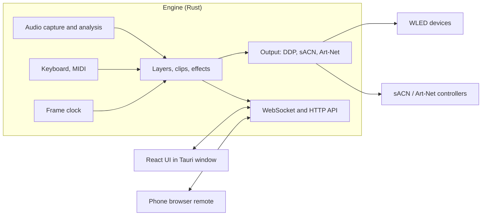

# Architecture

Decided on 2026-11-10. As of version 0.1.0 the engine, the device simulator and the UI exist; the desktop
shell, live mode and the timeline do not. Sections say which parts are built. Items marked **(to verify)** are
assumptions that the checks in [roadmap.md](roadmap.md) test.

## Why installed software, not a website

A browser cannot do the core jobs:

- It cannot send UDP, so no DDP, sACN or Art-Net.
- It cannot discover devices by mDNS.
- It can capture system audio only in Chrome/Edge on Windows, after the user ticks a box each time; on Linux it
  offers tab audio only.
- Timers are throttled in background tabs, which breaks a steady frame clock.
- A hosted HTTPS site that talks to `http://wled.local` hits Chrome's local-network permission prompts.
  [Chrome docs](https://developer.chrome.com/docs/modern-web-guidance/guides/security/local-network-access)

So a native engine is required. The UI is still built with web technology and served by that engine, which means
a phone on the same network can open it as a remote. A public website is only needed for a landing and docs page.

## Stack

| Part | Choice | Why |
|---|---|---|
| Engine | Rust, a headless process | Steady 60 fps with no garbage-collector pauses; good audio, MIDI and network crates |
| UI | TypeScript, React, Vite | Largest contributor pool; modern look is easy; WebGL2 for the preview, Canvas for the timeline |
| Desktop shell | Tauri v2 (not built yet; the UI opens in the browser) | Small installers, auto-update, Windows and Linux packaging |
| Engine to UI | WebSocket and HTTP on localhost | Keeps the shell replaceable; also serves the phone remote and a headless mode |



### The Linux webview risk

Tauri uses the system WebKitGTK on Linux. Tauri's docs carry a page of workarounds for Linux graphics problems,
WebGPU is not confirmed there, and the Chromium (CEF) backend for Tauri has no release date.
[Tauri Linux graphics](https://v2.tauri.app/develop/debug/linux-graphics/)

Mitigation: the UI talks to the engine only over the WebSocket, never through Tauri-specific calls for show
logic. If WebKitGTK is too slow, the same UI runs in Electron on Linux with no engine changes. Design for WebGL2,
not WebGPU.

### Alternatives considered

- **Pure Rust UI (egui + wgpu):** one process and the lowest latency, but a utilitarian look, a hand-built
  timeline and a smaller contributor pool. Kept as the fallback if the web UI cannot hit preview frame rates.
- **Python (like LedFx):** fast to start, but timing jitter at tens of thousands of pixels.
- **C++ with Qt or JUCE:** proven in lighting (QLC+, Chataigne) but slower to build and harder to attract help.
- **.NET with Avalonia:** productive, weaker real-time audio and MIDI libraries.
- **Electron everywhere:** consistent Chromium, at about 100 MB more download. Held in reserve for Linux.

## Core design: one engine, three ways to drive it

### Layout

- A **device** is something on the network: a WLED box, an sACN controller.
- A **fixture** is a strip, matrix or custom shape on a device output, with a pixel count and a position on a 2D
  canvas (3D later).
- **Groups** collect fixtures.
- Effects render in layout space, so one effect can sweep across fixtures on different devices.
- The user never sees universe or channel numbers. The engine derives packets from the layout.

### Clips, layers and modulators

- A **clip** is an effect instance with its parameters. Clips sit on **layers**, and layers blend (normal, add,
  multiply, mask).
- The three modes differ only in what starts and stops a clip:

| Mode | What starts a clip | Typical parameter source |
|---|---|---|
| Audio-reactive | Always on | Audio bands, beat |
| Live | Key or MIDI press (flash, toggle, hold) | Knobs, tap tempo |
| Timeline | The playhead reaching it | Curves drawn by the user |

- A **modulator** drives any parameter: a curve, an audio band, the beat phase, an LFO or a MIDI control. The
  same system works in every mode.
- **Record live into the timeline:** because live triggers and timeline clips are the same thing, a keyboard
  performance played over a song can be recorded as clips and then edited. This is the intended fast path for
  making pre-programmed shows.
- Every change goes through a command. The same commands will serve the UI, the phone remote, MIDI mappings
  and recording. Commands are validated in one place (`crates/engine/src/commands.rs`). Undo is not built.

Built so far: layers that are always on (the audio-reactive case), four blend modes, scenes. Clips with start
and stop times, modulators other than audio, and recording are not built.

### Effects

- An effect is a function of time, audio features, parameters and pixel positions that writes colours.
- Each effect declares its parameters (name, type, range) so the UI builds controls automatically.
- Built-in effects are Rust. Later, user effects as WGSL shaders or WASM plugins.
- Effects work with the colours a colour picker shows, as floating point. Gamma and the brightness cap are
  applied per device at the end; colour order and RGBW conversion will go there too.

### Timing and threads

- Audio callback thread: copies samples into a lock-free ring buffer and does nothing else.
- Analysis thread: FFT and features per hop.
- Render thread: fixed tick (60 fps by default, capped per device), renders layers, hands frames to output.
- Output: UDP sends, paced per device.
- API and discovery: async tasks (tokio).
- Clock: a monotonic clock in audio-reactive and live modes; the audio playback position in timeline mode, so
  lights stay locked to the song.

## Audio with zero setup

| OS | Method | Status |
|---|---|---|
| Windows | WASAPI loopback of the default output, through `cpal`: opening an output device as an input stream enables loopback. Needs no driver or user setting. [Microsoft](https://learn.microsoft.com/en-us/windows/win32/coreaudio/loopback-recording) | Written and compiles for Windows; not yet run on Windows |
| Linux | The monitor source of the default sink, through the PulseAudio protocol with the pure-Rust `pulseaudio` client. PipeWire answers the same protocol. | Tested on PulseAudio 16.1 and PipeWire 1.0.5 |
| macOS | A CoreAudio tap on the default output through `cpal` (macOS 14.6+) | Same code path as Windows; untested |

Why Linux does not use `cpal`: in `cpal` 0.18.2 the PulseAudio host either delivers recordings in chunks of
about two seconds (default buffer) or drops about half the audio (fixed buffer). Both were measured on
2026-11-10. A fix is unreleased upstream. Talking to the server directly with a 10 ms fragment size delivers
all of it.

- Follows the default device when the user switches headphones or speakers (checked every two seconds), and
  reconnects if the sound server restarts.
- Analysis (`crates/audio/src/analysis.rs`): mono mix, a 2048-sample windowed FFT every 512 samples at
  48 kHz, 32 mel bands, automatic gain, onset detection by spectral flux, and a tempo and beat tracker
  (autocorrelation of onset strength, 70 to 190 BPM). Tap tempo is not built.
- Each band is levelled against its own recent peaks, so treble shows next to a loud kick. The tempo tracker
  uses the unlevelled signal, weighted toward bass, so hi-hats are not mistaken for the beat.
- Latency offset per device. Loopback audio arrives before a Bluetooth speaker plays it, so lights sometimes need
  to be delayed, not sped up.
- Optional later on Windows: capture one application only, so notification sounds do not flash the lights
  (process loopback, documented for recent Windows builds).
- For timeline mode, songs are decoded with `symphonia` and analysed ahead of time for a beat grid and waveform.

## Outputs

### WLED (first-class)

- **Discovery:** mDNS service `_wled._tcp`.
- **Auto-setup:** `GET /json/info` gives `leds.count`, `leds.matrix.w` and `.h` for 2D setups, `name`, `mac`,
  `ver`, `arch`, and whether another source is streaming (`live`, `lm`, `lip`).
  [JSON API](https://kno.wled.ge/interfaces/json-api/)
- **Streaming:** DDP on UDP port 4048. [DDP in WLED](https://kno.wled.ge/interfaces/ddp/)

| Byte | Meaning |
|---|---|
| 0 | Flags: `0x40` version 1, `0x01` push (set on the last packet of a frame) |
| 1 | Sequence number (low 4 bits) |
| 2 | Data type: `0x0B` RGB, `0x1B` RGBW |
| 3 | Destination ID, 1 = default display |
| 4-7 | Data offset in bytes, big-endian |
| 8-9 | Data length, big-endian |

  Up to 1440 data bytes per packet (480 RGB pixels).
- **Settings that fight realtime:** WLED applies its own brightness and gamma to realtime data unless "Disable
  realtime gamma correction" and "Force max brightness" are set, and streaming to segments needs "Use main
  segment only". The app should detect and explain these.
- **Handing back:** stop streaming on exit so WLED returns to its own effects after its realtime timeout.
- **Limits:** an ESP32 on WiFi handles roughly 500 to 1000 pixels at 40 to 60 fps **(estimate, to verify)**.
  Larger props want an Ethernet board. Show per-device frame rate and dropped frames in the UI.

### Generic pixel controllers

- **sACN (E1.31) and Art-Net:** 512 channels per universe, so 170 RGB pixels. Covers Falcon, Kulp, HinksPix,
  Advatek PixLite and DMX nodes. WLED also accepts these but caps universes (12 on ESP32 in the source), which is
  why DDP is preferred for WLED. [WLED E1.31](https://kno.wled.ge/interfaces/e1.31-dmx/)
- **`.fseq` v2 export and FPP upload:** render a timeline show to a file that a Falcon Player runs on its own.
- **xLights layout import:** read models and positions from an existing xLights setup.

### Later, optional

DMX fixtures (pars, moving heads) over Art-Net or sACN, Enttec DMX USB Pro, Philips Hue Entertainment, OpenRGB,
Hyperion. None is needed for the first four milestones.

## Engine to UI protocol

Built. One WebSocket per client at `/ws`; the engine also serves the UI over HTTP from the same port (7420).

| From the engine | Content |
|---|---|
| text `hello` | Version, the effect list with each effect's parameters, palettes. Sent once. |
| text `state` | The whole show. Sent on connect and after every change. |
| text `audio` | Audio features, 30 times a second. |
| text `status` | Frame rate, per-device send counts, audio status, discovered devices. Once a second. |
| text `result` | Outcome of a command that carried an `id`. |
| binary, first byte 1 | Preview colours: RGB per pixel, 30 times a second. |
| binary, first byte 2 | Canvas position of every pixel, sent when the layout changes. |

Binary messages carry a layout serial in bytes 4 to 8, and the payload starts at byte 8. A client only applies
colours whose serial matches the positions it holds.

Clients send commands as JSON text. The UI builds effect controls from the `hello` message, so adding an effect
needs no UI code.

### Who may connect

- The server listens on this computer only (127.0.0.1) unless started with `--lan`.
- Any web page can try to open a WebSocket to localhost, so the server checks two headers. `Host` must name
  this machine, which defeats DNS rebinding. `Origin` must be the page the server itself served.
- With `--lan` there is no password yet: anyone on the network can control the lights, and the `Host` check is
  off. A pairing code is planned before this is recommended.

## Project files

Built: the show is one human-readable JSON file with a format version, saved a moment after each change to the
user's config folder (or the path given with `--show`). It is written to a temporary file and renamed, so a
crash cannot truncate it. A file that cannot be read, or that comes from a newer version, is kept as `.bak` and
reported in the UI.

Planned: a folder per show with a `media/` folder for songs and images. Shared shows leave the songs out.

## Rust crates in use

| Need | Crate | Note |
|---|---|---|
| Audio capture, Windows and macOS | `cpal` 0.18 | WASAPI loopback, CoreAudio tap |
| Audio capture, Linux | `pulseaudio` 0.3 | Pure-Rust client for the PulseAudio protocol |
| FFT | `rustfft` | |
| Beat tracking | own code | `aubio` bindings are GPL-3 and stale |
| mDNS | `mdns-sd` | |
| DDP | own code | The header is 10 bytes (`crates/output/src/ddp.rs`) |
| WLED HTTP | `ureq` | Requests never go through a system proxy |
| Server | `axum`, `tokio` | |
| Embedding the UI | `rust-embed` | The built UI is compiled into the program |
| Frame pacing | `spin_sleep` | |

Planned: `midir` (MIDI), `sacn` (sACN), own code for Art-Net, `symphonia` (song decoding).

Open-source projects worth reading: [LedFx](https://github.com/LedFx/LedFx) (audio effects),
[Mizer](https://github.com/maxjoehnk/Mizer) (Rust lighting engine with a Flutter UI),
[Rustmas](https://github.com/mrozycki/rustmas), [xLights](https://github.com/xLightsSequencer/xLights) (effects
and file formats).

## Repo layout

```
crates/
  darkrgb-core/     layout, layers, effects, renderer (no I/O)
  darkrgb-audio/    capture and analysis
  darkrgb-output/   DDP, WLED info, discovery
  darkrgb-engine/   the program: frame loop, commands, server, diagnostics
  darkrgb-sim/      a pretend WLED device for tests and demos
ui/             React + Vite
docs/
```

Planned: `apps/desktop/` for the Tauri shell.
